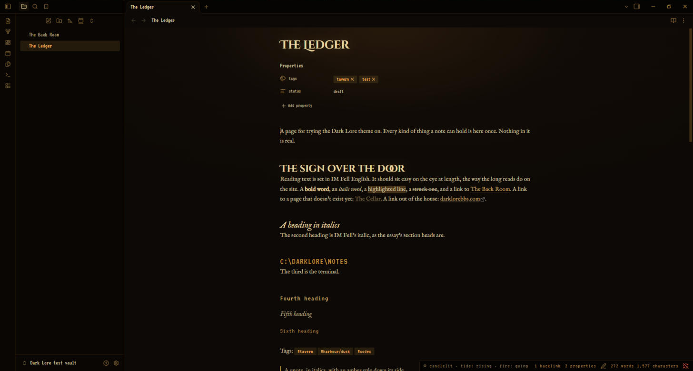
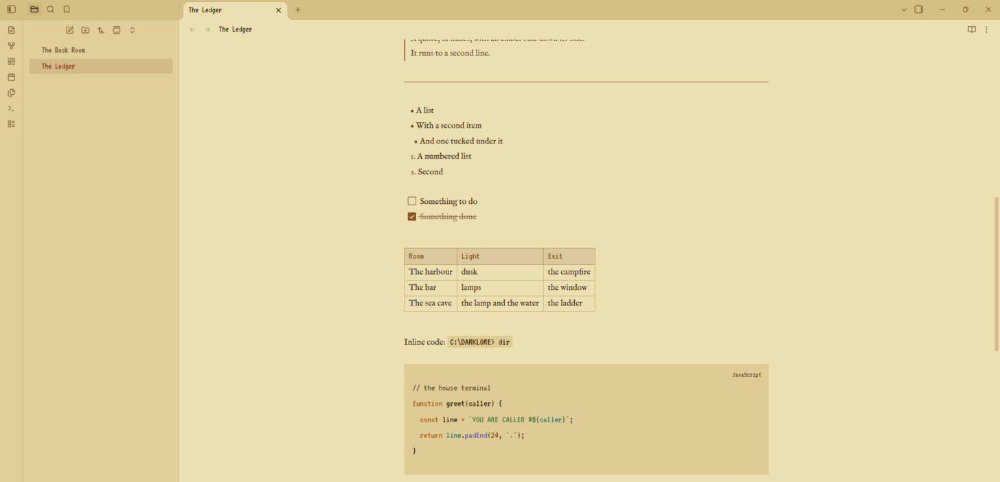

# Dark Lore

A theme for Obsidian, from [darklorebbs.com](https://www.darklorebbs.com): an island tavern at dusk, with a BBS in the corner.



## What's in it

- **Dark** is the tavern at night: dark wood, parchment text, amber light, a faint lamp over every page.
- **Light** is parchment and ink, with links and tags in red ink.
- **Three typefaces.** Reading text is IM Fell English. Titles are Cinzel Decorative. The house terminal is VT323: menus, code, tags, tables and the smaller headings.
- Links underlined in dots. Square corners. Note boxes in amber, info in lilac, to-dos in gold.
- The status bar keeps the house's line: `☼ candlelit · tide: rising · fire: going`. The command palette asks *What'll it be?*



## Install

**From Obsidian:** Settings → Appearance → Themes → Manage, search for *Dark Lore*, then Use.

**By hand:** download `manifest.json` and `theme.css` from the [latest release](https://github.com/gudetamafu/dark-lore-obsidian/releases/latest), put them in `<your vault>/.obsidian/themes/Dark Lore/`, and pick *Dark Lore* under Settings → Appearance → Themes.

Needs Obsidian 1.13 or newer. Tested on Obsidian 1.15 on Windows. Not yet tried on phones or tablets.

## The fonts

All three are embedded in `theme.css`, so the theme works offline and makes no network calls. That's why the file is about 400 KB.

- **IM Fell English** by Igino Marini
- **Cinzel Decorative** by Natanael Gama
- **VT323** by Peter Hull and the VT323 Project Authors

They are complete and unmodified, under the SIL Open Font License 1.1, with their copyright notices, in [`OFL.txt`](OFL.txt). A font you pick in Settings → Appearance still wins over the theme's.

## Building

`theme.css` is built from `src/theme.css`. `build.py` fetches the original fonts from [google/fonts](https://github.com/google/fonts), checks them against recorded hashes, embeds them, and proves each one identical to the original, table for table, before it writes.

```
pip install fonttools zopfli
python build.py
```

## Licence

The theme's own code is under the MIT licence ([`LICENSE`](LICENSE)). The embedded fonts are under the SIL Open Font License 1.1 ([`OFL.txt`](OFL.txt)).

## Coffee

Dark Lore is free. Coffee money, if you've a coin and the mood: [ko-fi.com/darklorebbs](https://ko-fi.com/darklorebbs).
